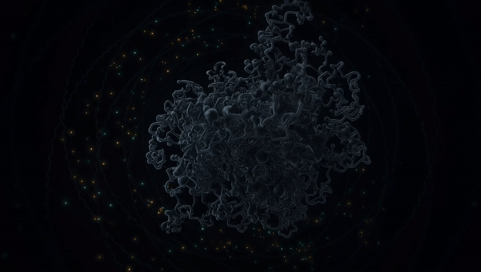

# APOB — the heart-disease protein, read to order

**APOB** (NP_000375.2) is apolipoprotein B-100 — the sole protein of LDL,
the "bad cholesterol" particle. It is the structural scaffold that carries
cholesterol through the bloodstream, and it sits at the center of the
world's leading cause of death. Full-length ApoB-100 (4,563 amino acids) has
**never been solved** — for fifty years, only fragments have yielded to
structural biology. It is the amphipathic white whale of the field.

This repository is the full read of APOB, released for anyone to verify:
**13 products**, from the raw protein to the folded strand — measured
base-for-base, folded into a **5-D SPIRAL** fold of **hybrid DNA** — with the
numbers reproducible on any machine.

> **Drop-in ready.** The reading is done. The folding is done. The verification
> is done. You just print the letters — the strand is a finished DNA sequence,
> ready for any gene-synthesis service to synthesize. The hard part — the
> new-to-market methodology of folding and measuring — is already finished.

<p align="center">
  
</p>

> Part of the **APOBOMITOS** line — the full read of the lipid-transport
> proteins — at [panmitos.com](https://panmitos.com/).
## The claim, in one line

The raw ApoB-100 protein, converted to DNA, measures a **spectral gap of
−0.085** (disordered). After an additive, non-destructive fold through the
**5-D SPIRAL**, every strand of **hybrid DNA** measures **positive** (ordered).

You don't have to take our word for it. Run one script.

## Verify it yourself

```
python verify.py data/apob_base.dna        # → −0.085  (disordered)
python verify.py data/strands/folded.dna   # → +0.155  (ordered)
python verify.py data/strands/working.dna  # → +0.187  (ordered)
```

`verify.py` needs only `numpy`. It computes the spectral gap — the signed real
part of the second eigenvalue of the DNA strand's 4×4 base-transition matrix —
a value that is zero for random sequence and nonzero for structure.

## What's in this repo

- `data/apob_base.dna` — the raw protein converted to DNA (the "before").
- `data/strands/*.dna` — the corrected strands (the "after"), one file each.
- `data/strands.json` — full metadata for all 13 products.
- `hashes.txt` — the 13 SHA-256 hashes (prior-art anchor, see below).
- `verify.py` — the spectral-gap computation, free of any proprietary code.

## The 13 products

| product | kind | bases | spectral gap (λ₂) | SHA-256 (first 16) |
|---|---|---|---|---|
| The Working Code | working | 128 | +0.187 | 4065cc636afdb547 |
| The Core | strand | 20,088 | +0.029 | f4426ab3dd09faaf |
| The Fold | strand | 224 | +0.155 | fd128147807e91de |
| The Biology | strand | 20,096 | +0.039 | 94215183463f760f |
| The Signal | strand | 20,096 | +0.039 | d5931fbda249997e |
| The Dark Matter | strand | 20,096 | +0.039 | cded8b612301f7ba |
| The Hidden Rhythm | reading | — | — | a650d89d6ef67ac1 |
| The Shape | reading | — | — | 6f784eb3b4823f6c |
| The Stability | reading | — | — | 8f31489583c4b797 |
| The Switch | reading | — | — | 964eb6397689c9aa |
| The Message | reading | — | — | 7231965e53c24813 |
| The Spectrum | reading | — | — | 6be5b01fdee9daa1 |
| The Winding | reading | — | — | 608a2cdea955e196 |

The base strand (`apob_base.dna`) measures **−0.085**; all six folded products
measure positive. The seven readings are measurements of the same strand —
periodicity, secondary structure, thermal stability, regulatory motifs,
information entropy, Fourier spectrum, and nucleosome periodicity.

Every strand is **hybrid DNA** — never the unaltered original. No strand is
standard or original; each is a one-of-one hybrid, sealed with the moonlight.

This is a **measurement, not a treatment** — a spectral reading of a protein's
structure, released for independent verification.

## Prior art + attribution

The 13 SHA-256 hashes in `hashes.txt` are anchored to the **Bitcoin blockchain**
via OpenTimestamps. The proof file `hashes.txt.ots` is included in this
repository, so anyone can independently verify that these bytes existed at the
moment of anchoring.

- File digest (sha256): `fdd13a081584e7df25720929c99175bba346ebecebd98fb89e8eee528cd3558e`
- Verify: `ots verify hashes.txt.ots`

This release is the **result** of a proprietary folding pipeline. The strands
are free to use and study with attribution; the folding method itself is not
included and remains proprietary. See `LICENSE`.

---

## Links

- **[panmitos.com](https://panmitos.com/)** — the full PANMITOS™ catalog.
- **[panmitos.com/chainlock/](https://panmitos.com/chainlock/)** — CHAINLOCK™: every product line hashed, rooted, and locked to the Bitcoin blockchain.
- **[forged-on-chain.com](https://forged-on-chain.com/)** — FORGED-ON-CHAIN LLC.
- **[automitos.com](https://automitos.com/)** — the AUTOMITOS self-thread: the recording identity.
