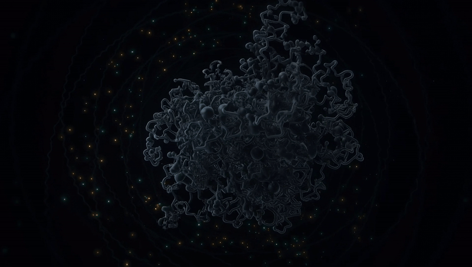

# APOB — measured, folded, released

**APOB** (NP_000375.2) is apolipoprotein B-100 — the sole protein of LDL,
the "bad cholesterol" particle. It is the structural scaffold that carries
cholesterol through the bloodstream, and it sits at the center of the world's
leading cause of death. Full-length ApoB-100 (4,563 amino acids) remains
structurally unsolved.

**We did not solve it.** We back-translated its amino-acid sequence to DNA,
measured the spectral gap, folded the strand, and released the result. That is
the extent of the claim.

This repository is a measurement of APOB: the sequence back-translated to DNA,
its spectral gap measured, the strand folded through a deterministic
**5-D SPIRAL**, and the resulting **hybrid DNA** sequences released for anyone
to synthesize. **13 products**, reproducible on any machine with one script.

> **Drop-in ready.** The strand is a finished DNA sequence — print the letters
> and hand them to any gene-synthesis service. Nothing to recalibrate: the
> back-translation, the measurement, and the fold are already done. You
> synthesize, then you test.

<p align="center">
  
</p>

> Part of the **APOBOMITOS** line — the measurement of the lipid-transport
> proteins — at [panmitos.com](https://panmitos.com/).

## What we did — and did not

We did three things, and nothing more:

1. **Back-translated** the ApoB-100 amino-acid sequence into DNA through the
   standard genetic code.
2. **Measured** the spectral gap — the signed real part of the second
   eigenvalue of the strand's 4×4 base-transition matrix.
3. **Folded** the strand through an additive, non-destructive 5-D spiral, and
   released the result.

We did **not** solve ApoB's structure. A spectral gap is a number. What a
positive spectral gap means in a cell is an open question — and it is the
question this repository hands to you.

## The numbers

The raw sequence, back-translated to DNA, measures a **spectral gap of −0.085**
(the "before"). After the fold, every strand of hybrid DNA measures **positive**
(the "after"): **+0.029 to +0.187**.

You don't have to take our word for it. Run one script.

## Verify it yourself

```
python verify.py data/apob_base.dna        # → −0.085  (before)
python verify.py data/strands/folded.dna   # → +0.155  (after)
python verify.py data/strands/working.dna  # → +0.187  (after)
```

`verify.py` needs only `numpy`. It computes the spectral gap — the signed real
part of the second eigenvalue of the DNA strand's 4×4 base-transition matrix —
a value that is zero for random sequence and nonzero for structure.

## What to test

The strands are finished DNA sequences. Print the letters and synthesize them.
The specific test:

- Synthesize the folded strand, express it alongside the base strand.
- Measure what changes — LDL assembly, cholesterol binding, solubility.
- **We predict a shift. We do not claim it works. The cell reports.**

## The one claim that verifies itself

Independently, we encode data into DNA and decode it back losslessly —
GC-balanced, homopolymer-limited, error-corrected. Encode → synthesize →
sequence → decode == original. That claim is falsifiable in a day and needs no
biology to cooperate.

## What's in this repo

- `data/apob_base.dna` — the back-translated sequence (the "before").
- `data/strands/*.dna` — the folded strands (the "after"), one file each.
- `data/strands.json` — full metadata for all 13 products.
- `hashes.txt` — the 13 SHA-256 hashes (prior-art anchor, see below).
- `verify.py` — the spectral-gap computation, free of any proprietary code.

## The 13 products

| product | kind | bases | spectral gap (λ₂) | SHA-256 (first 16) |
|---|---|---|---|---|
| The Working Code | working | 128 | +0.187 | 4065cc636afdb547 |
| The Core | strand | 20,088 | +0.029 | f4426ab3dd09faaf |
| The Fold | strand | 224 | +0.155 | fd128147807e91de |
| The Biology | strand | 20,096 | +0.039 | 94215183463f760f |
| The Signal | strand | 20,096 | +0.039 | d5931fbda249997e |
| The Dark Matter | strand | 20,096 | +0.039 | cded8b612301f7ba |
| The Hidden Rhythm | reading | — | — | a650d89d6ef67ac1 |
| The Shape | reading | — | — | 6f784eb3b4823f6c |
| The Stability | reading | — | — | 8f31489583c4b797 |
| The Switch | reading | — | — | 964eb6397689c9aa |
| The Message | reading | — | — | 7231965e53c24813 |
| The Spectrum | reading | — | — | 6be5b01fdee9daa1 |
| The Winding | reading | — | — | 608a2cdea955e196 |

The base strand (`apob_base.dna`) measures **−0.085**; all six folded products
measure positive. The seven readings are measurements of the same strand —
periodicity, secondary structure, thermal stability, regulatory motifs,
information entropy, Fourier spectrum, and nucleosome periodicity.

Every strand is **hybrid DNA** — never the unaltered original. No strand is
standard or original; each is a one-of-one hybrid, sealed with the moonlight.

This is a **measurement, not a treatment** — a spectral reading of a protein's
sequence, released for independent verification.

## Prior art + attribution

The 13 SHA-256 hashes in `hashes.txt` are anchored to the **Bitcoin blockchain**
via OpenTimestamps. The proof file `hashes.txt.ots` is included in this
repository, so anyone can independently verify that these bytes existed at the
moment of anchoring.

- File digest (sha256): `fdd13a081584e7df25720929c99175bba346ebecebd98fb89e8eee528cd3558e`
- Verify: `ots verify hashes.txt.ots`

This release is the **result** of a proprietary folding pipeline. The strands
are free to use and study with attribution; the folding method itself is not
included and remains proprietary. See `LICENSE`.

---

## Links

- **[panmitos.com](https://panmitos.com/)** — the full PANMITOS™ catalog.
- **[panmitos.com/chainlock/](https://panmitos.com/chainlock/)** — CHAINLOCK™: every product line hashed, rooted, and locked to the Bitcoin blockchain.
- **[forged-on-chain.com](https://forged-on-chain.com/)** — FORGED-ON-CHAIN LLC.
- **[automitos.com](https://automitos.com/)** — the AUTOMITOS self-thread: the recording identity.
